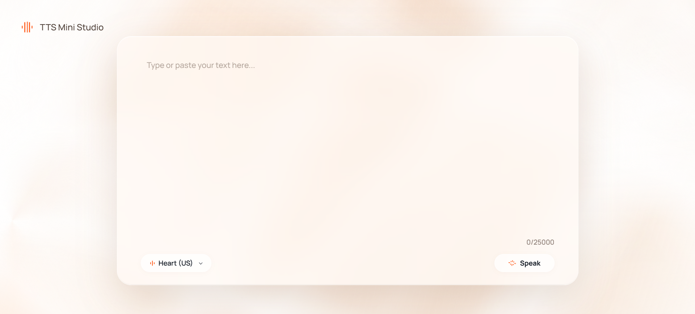

# TTS Mini Studio

Live Demo - https://apertso.github.io/tts-mini-studio

**Built with Fish Audio.** Speech is generated by [Fish Audio Drama 3](https://huggingface.co/fishaudio/drama-3), licensed under the Fish Audio Community License.



## What Is Where

- Backend API: `tts/` (entrypoint: `python -m tts`)
- Frontend app: static files in `docs/`

## Quick Start

Requires **Python 3.11**.

### 1) Install backend dependencies

```bash
python -m pip install -r requirements.api.txt
```

### 2) Start API + frontend together

```bash
just dev
```

This starts:

- API at `http://127.0.0.1:5000`
- Frontend at `http://127.0.0.1:8080`

## Speech provider

The studio uses Fish Audio Drama 3 for English and Russian text up to 50,000 characters. Copy `.env.example` to `.env` for local development, or set the variables in the Flask or RunPod worker environment. Restart the backend after changes. Flask's `/health` reports the selected provider and whether its required setting is present.

### OpenRouter

OpenRouter is the default. [Drama 3 on OpenRouter](https://openrouter.ai/fish-audio/drama-3)

```
TTS_PROVIDER=openrouter
OPENROUTER_API_KEY=sk-or-v1-...
```

### Self-hosted Drama 3 on RunPod

1. Start the official Fish Speech HTTP server with the `fishaudio/drama-3` checkpoint on a RunPod GPU Pod or a load-balancing Serverless endpoint. Fish Audio lists NVIDIA GPUs with at least 48 GB of VRAM for the FP8 checkpoint. The 48 GB card must support FP8 (Ada or newer: L40S, L40, RTX 6000 Ada). Ampere cards such as the A40 and RTX A6000 load the experts dequantized to bf16 and run out of memory at startup. Serve the native `/v1/tts` and `/v1/references/list` routes. [Fish Speech installation](https://speech.fish.audio/install/) · [Fish Speech inference](https://speech.fish.audio/inference/)
2. Provide the voice references. The self-hosted catalog (`SELF_HOSTED_VOICES` in [`tts/voices.py`](tts/voices.py)) has four English voices, four Russian voices and the reference-free `surprise`. Every voice reads both languages. Each ID needs `sample.wav` and its `sample.lab` transcript in `references/<id>/` on each inference worker. The bundled clips in [`assets/voice_references/`](assets/voice_references) come from public LibriVox datasets and the Dialogs studio corpus; see [`assets/VOICE_SOURCES.md`](assets/VOICE_SOURCES.md). The Dialogs voices (Masha, Sveta, Dima) are licensed under OpenRAIL: audio made with them must follow the use restrictions in [`assets/voice_references/LICENSE-DIALOGS.md`](assets/voice_references/LICENSE-DIALOGS.md). [`Dockerfile.runpod-drama3`](Dockerfile.runpod-drama3) copies them to `/app/references`. The app reports missing references by ID. The Fish cloud voices (`CLOUD_VOICES`) apply only to the OpenRouter provider.
3. Set these variables on the studio backend. Use the Fish Speech server's base URL, such as `https://<pod-id>-8080.proxy.runpod.net` for a GPU Pod or `https://<endpoint-id>.api.runpod.ai` for a load-balancing endpoint. Set `FISH_SPEECH_API_KEY` to the Fish Speech bearer token for an authenticated Pod or the RunPod API key for a load-balancing endpoint. [RunPod Pod ports](https://docs.runpod.io/pods/configuration/expose-ports) · [RunPod load balancing](https://docs.runpod.io/serverless/load-balancing/overview)

   ```dotenv
   TTS_PROVIDER=fish-speech
   FISH_SPEECH_BASE_URL=https://your-model-server.example
   FISH_SPEECH_API_KEY=your-bearer-token
   ```

With `just dev`, the browser uses Flask and Flask calls the model server. For the hosted studio, the request path is **browser → Cloudflare Worker → RunPod queue worker → Fish Speech**.

1. Build the studio queue worker with `docker build -f Dockerfile.runpod -t <registry>/<image>:<tag> .`, push the image to your registry, and deploy it to a queue-based Serverless endpoint with the variables above. The worker calls the GPU deployment from the previous section. [RunPod queue endpoints](https://docs.runpod.io/serverless/endpoints/overview)
2. Set `RUNPOD_ENDPOINT_ID` and the `RUNPOD_API_KEY` secret on the Cloudflare Worker from [`worker/src/index.js`](worker/src/index.js). The ID identifies the queue endpoint. Set `ALLOWED_ORIGIN` to the frontend origin and point `runpodProxyUrl` in [`docs/config.js`](docs/config.js) at the Worker's `/api/runpod` route.
3. For WAV files over 6.5 MB, configure `BUCKET_ENDPOINT_URL`, `BUCKET_ACCESS_KEY_ID`, `BUCKET_SECRET_ACCESS_KEY`, and `RUNPOD_AUDIO_BUCKET_NAME` on the queue worker. The worker uses S3-compatible storage and returns a downloadable URL. Test a short English or Russian job first, then a longer job to verify the bucket and tune the timeouts if needed. The Cloudflare Worker gives each job a 30-minute execution timeout; set `RUNPOD_EXECUTION_TIMEOUT_MS` on the Worker to change it.
